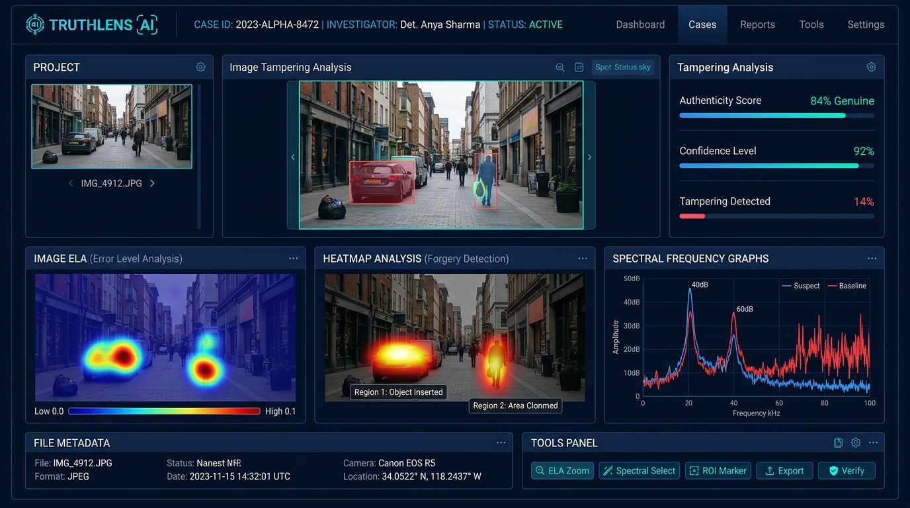
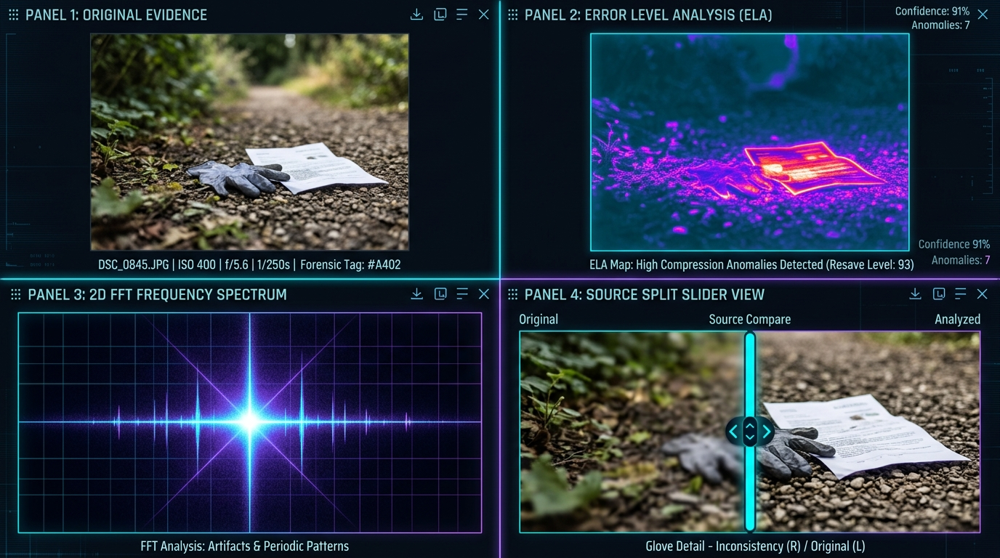
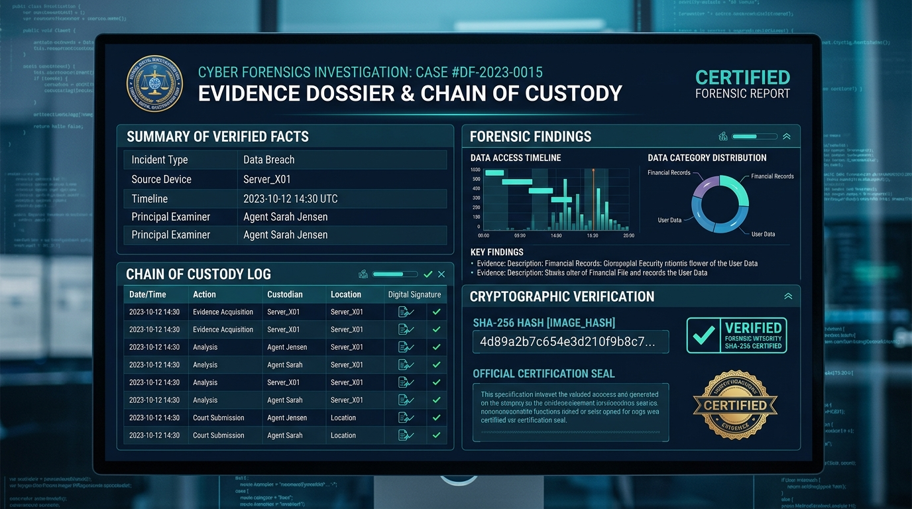

# 🔍 TruthLens AI — AI-Powered Image Forensics & Digital Evidence Investigation Platform

<p align="center">
  
</p>

<div align="center">

# 🛡️ TRUTHLENS AI
### *Investigate the image. Discover the evidence. Verify the source.*

[](https://github.com/Sashank096/truthlens-ai/actions/workflows/ci.yml)
[](LICENSE)
[](https://www.python.org/)
[](https://fastapi.tiangolo.com)
[](https://react.dev)
[](https://www.typescriptlang.org/)
[](https://tailwindcss.com)
[](https://c2pa.org/)
[](https://www.reportlab.com/)

**[🌐 Live GitHub Repository](https://github.com/Sashank096/truthlens-ai)** • **[⚡ Quick Triage Engine](http://127.0.0.1:5173)** • **[📑 Interactive Swagger API](http://127.0.0.1:8000/docs)** • **[🐳 Docker Deployment](#-docker--container-orchestration)**

</div>

---

## 📌 Executive Summary

**TruthLens AI** is an enterprise-grade digital image forensics workstation and evidence custody platform engineered for **cyber incident responders, intelligence analysts, investigative journalists, law enforcement, and legal counsel**.

Unlike superficial reverse image search engines or black-box "AI detectors" that guess without accountability, TruthLens AI combines **computational physics, compression error mechanics, optical frequency spectrums, cryptographic provenance (C2PA), and perceptual reverse source discovery** into a single, tamper-evident investigation dossier.

Deployed Link:https://truthlensai-orcin.vercel.app/

---

## 🚨 The Problem: Why Digital Forensics is Broken

Modern visual manipulation has outpaced conventional digital verification methods:

```
┌────────────────────────────────────────────────────────────────────────┐
│                   THE DIGITAL DISINFORMATION CRISIS                     │
├────────────────────────────────────────────────────────────────────────┤
│ 1. AI Deepfakes & Diffusion Engines (FLUX, Midjourney, Stable Diff.)   │
│ 2. "Cheapfakes" & Splicing: Subtle cut-and-paste composites            │
│ 3. Social Media Sanitization: WhatsApp/X strip EXIF & re-encode JPEGs  │
│ 4. The Black-Box AI Fallacy: "AI Detector" scores cannot be verified   │
│ 5. Broken Chain of Custody: Evidence is dismissed in legal scrutiny    │
└────────────────────────────────────────────────────────────────────────┘
```

- **The Verification Void**: When an altered photo circulates during a geopolitical crisis, cyber extortion case, or criminal trial, standard image viewers show only superficial pixels.
- **The Black-Box Failure**: Existing cloud AI detectors return a generic "87% AI" label with zero explanation. In a court of law or intelligence briefing, this is inadmissible hearsay.
- **Fragmented Tools**: Investigators are forced to manually juggle disconnected command-line utilities for EXIF parsing, ELA differences, and perceptual hashing.

---

## 💡 What TruthLens AI Solves

TruthLens AI delivers a deterministic, reproducible, and explainable multi-signal investigation workstation:

| Challenge | Traditional Approach | TruthLens AI Solution |
| :--- | :--- | :--- |
| **Tampering Detection** | Subjective visual review | **Multi-Channel ELA**: False-color Jet thermal heatmaps exposing compression quantization differences |
| **Synthetic AI Artifacts** | Unreliable binary classifiers | **2D Fast Fourier Transform (FFT)**: Unmasks periodic grid lattices and high-frequency generator spikes |
| **Composite Splicing** | Easy to miss feathered edges | **PRNU Sensor Noise Variance**: Laplacian residual filtering detects multi-camera silicon noise mismatches |
| **Evidence Admissibility** | Screenshots and manual notes | **Immutable SHA-256 Vault**: Timestamped chronological custody logs with ReportLab certified PDF dossiers |
| **Origin Verification** | Generic web search | **Perceptual Reverse Matching**: pHash, SSIM, and ORB feature keypoint diffing against reference archives |
| **Provenance Integrity** | Ignored or unparsed | **Native C2PA JUMBF Manifests**: Cryptographic certificate inspection via `c2pa-python` |

---

## 🔬 Multi-Layer Forensic Suite in Action

<p align="center">
  
</p>

### 1. Panel 1: Original Evidence & Header Ingestion
- Ingests raw bytes with **zero alteration or re-compression**.
- Calculates client-side and server-side **SHA-256 digests** immediately upon intake.
- Extracts camera make/model, aperture, exposure time, focal length, ISO, and GPS coordinates with Google Maps links.
- Identifies editing software signatures (Adobe Photoshop, GIMP, Canva, Stable Diffusion).

### 2. Panel 2: Error Level Analysis (ELA) with Thermal Jet Heatmaps
- Re-compresses the image at calibrated quality baselines ($70\% - 98\%$) and multiplies pixel difference residuals by $18\times$.
- Generates a **false-color Jet heatmap** highlighting localized compression hotspots. Spliced elements that were saved at different compression levels glow red/yellow, while authentic backgrounds remain uniform.

### 3. Panel 3: 2D Fast Fourier Transform (FFT) Power Spectrum
- Transforms spatial image pixels into shifted log-magnitude frequency domains.
- Natural camera lenses produce a continuous Gaussian low-frequency roll-off.
- Generative diffusion engines, GANs, and digital upscalers leave unmistakable **periodic lattices, harmonic spikes, and cruciform frequency coordinates**.

### 4. Panel 4: Reverse Source Discovery & Interactive Split-Slider
- Searches the reference corpus using multi-hash perceptual fingerprinting (`pHash`, `dHash`, `wHash`, `SSIM`, and `ORB` feature descriptors).
- Provides an **interactive swipe Split-Slider** and **Pixel Difference Heatmap** allowing investigators to swipe directly between the suspicious evidence and the authenticated original wire photo.

---

## 📄 Certified Evidence Dossier & Chain of Custody

<p align="center">
  
</p>

TruthLens AI generates certified, courtroom-ready PDF reports via **ReportLab**:

- **Cryptographic Header**: Immutable case ID, investigator credentials, and verified SHA-256 digest.
- **Immutable Audit Trail**: Chronological event logs recording evidence acquisition, algorithm runs, and examiner notes.
- **Strict Separation of Facts vs. Estimates**:
  - **Verified Facts**: Cryptographic hash, container dimensions, validated C2PA certificate chains.
  - **Forensic Estimates**: ELA anomaly percentages, 2D FFT spectral variance, PRNU noise dispersion.
- **Embedded Visual Exhibits**: High-resolution embedded heatmaps, FFT spectrograms, and candidate difference overlays.
- **Official Legal Disclaimer**: Non-accusatory wording strictly separating mathematical findings from subjective intent.

---

## 📱 Responsive & Touch-Optimized Interface

TruthLens AI is engineered for both desktop command centers and field mobile investigations:

- **Touch-Friendly Split Slider**: Single-finger touch swipe (`touch-none`, `onTouchMove`) without scrolling interference.
- **Adaptive Breakpoint Canvases**: Dynamic viewport scaling (`h-[270px] sm:h-[380px] md:h-[450px]`) prevents mobile clipping.
- **Swipeable Horizontal Sub-Navs**: Smooth touch carousels for ELA, FFT, Noise, EXIF, C2PA, and Source Candidates.
- **Mobile Evidence Card View**: Automatically adapts multi-column data tables into touch cards on smartphone displays.
- **In-Browser WebCrypto Fallback Engine**: If the cloud backend is cold-starting or offline, pure client-side WebCrypto SHA-256 and HTML5 Canvas ELA ensure triage never fails.

---

## 🏗️ System Architecture

```
┌────────────────────────────────────────────────────────────────────────┐
│                        TRUTHLENS AI PLATFORM                           │
└───────────────────────────────────┬────────────────────────────────────┘
                                    │
       ┌────────────────────────────┴────────────────────────────┐
       ▼                                                         ▼
┌───────────────────────────────┐         ┌───────────────────────────────┐
│     truthlens_frontend        │  REST   │      truthlens_backend        │
│  - React 18 + TypeScript      │◄───────►│  - FastAPI + Python 3.10+     │
│  - Vite + Tailwind CSS        │  JSON   │  - OpenCV, Pillow, PyWavelets │
│  - Lucide React Icons         │         │  - c2pa-python, ImageHash     │
│  - Interactive Split-Slider   │         │  - SciPy, NumPy, ReportLab    │
│  - In-Browser Fallback Engine │         │  - SQLite & Supabase Storage  │
└───────────────────────────────┘         └───────────────────────────────┘
```

---

## 🚀 Quickstart & Local Setup

### Prerequisites
- **Python**: `3.10` or `3.11`
- **Node.js**: `18.x` or `20.x` with `npm`
- **Git**

### 1. Clone the Repository
```bash
git clone https://github.com/Sashank096/truthlens-ai.git
cd truthlens-ai
```

### 2. Backend Setup (`truthlens_backend`)
```bash
cd truthlens_backend

# Create virtual environment
python -m venv venv
# Windows:
venv\Scripts\activate
# Linux/macOS:
source venv/bin/activate

# Install dependencies
pip install -r requirements.txt

# Start FastAPI server
python -m uvicorn main:app --host 127.0.0.1 --port 8000 --reload
```
- API is running at: `http://127.0.0.1:8000`
- Interactive OpenAPI Swagger Docs: `http://127.0.0.1:8000/docs`

### 3. Frontend Setup (`truthlens_frontend`)
In a new terminal:
```bash
cd truthlens_frontend
npm install
npm run dev
```
- Open in browser: `http://127.0.0.1:5173`

### 4. Run Automated Test Suite
Verify all 7 forensic layers with the automated test suite:
```bash
cd truthlens_backend
python -m pytest test_backend.py -v
```

---

## 🐳 Docker & Container Orchestration

Run the complete platform with a single command using Docker Compose:

```bash
docker-compose up --build -d
```

- **Frontend Application**: `http://localhost:3000`
- **Backend REST API**: `http://localhost:8000`
- **API Health Endpoint**: `http://localhost:8000/api/health`

---

## 🛡️ Ethical Forensic Principles & Legal Notice

TruthLens AI adheres to the highest standards of digital forensics (SWGDE, ENFSI, and NIST):

1. **Non-Accusatory Analysis**: Mathematical algorithms measure physical anomalies; they do not establish human intent, guilt, or authorship.
2. **Deterministic Reproducibility**: All algorithmic transformations (FFT, ELA, Laplacian noise) are open-source and independently verifiable.
3. **Chain of Custody Preservation**: Evidence bytes are stored in an immutable vault verified by SHA-256 digests.

> **LEGAL NOTICE**: *TruthLens AI provides computational evidence analysis designed to assist qualified investigators. Algorithmic outputs are scientific estimates and do not constitute conclusive legal proof of authorship or intent. Final conclusions must always be corroborated by independent evidence.*

---

<div align="center">

**Built for investigators, journalists, intelligence analysts, and digital truth.**  
Made with ❤️ by the **TruthLens AI Team** • [GitHub Repository](https://github.com/Sashank096/truthlens-ai)

</div>
